<div align="center">

# 3310

**Hypnotic techno firmware for the M-VAVE FM-1, styled after a two-tone phone screen.**

[](https://github.com/orion-musica/3310_FM-1/actions/workflows/build.yml)


[**Website & web installer**](https://orion-musica.github.io/3310_FM-1/) ·
[Install](#installation) ·
[Manual](#using-3310) ·
[Build](#building-from-source) ·
[Design](#design-concepts) ·
[License](#license)

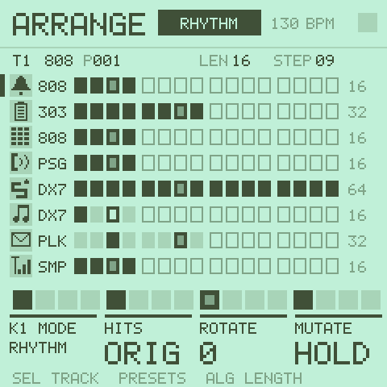

</div>

---

> [!WARNING]
> **3310 is experimental.** The code has been checked in a host simulator that runs the real screen
> code, but it has not yet been tested on many physical devices. Back up your FM-1 before you install it,
> and keep the original firmware within reach. The web installer can always put the stock V15 back.

## Contents

- [What is 3310](#what-is-3310)
- [Features](#features)
- [Screens](#screens)
- [Installation](#installation)
- [Using 3310](#using-3310)
- [Parameter reference](#parameter-reference)
- [What is not (yet) possible](#what-is-not-yet-possible)
- [Building from source](#building-from-source)
- [Project layout](#project-layout)
- [How it works](#how-it-works)
- [Design concepts](#design-concepts)
- [Troubleshooting](#troubleshooting)
- [Contributing](#contributing)
- [Credits](#credits)
- [License](#license)

## What is 3310

3310 is a free, open-source firmware for the **M-VAVE FM-1** pocket FM synthesizer. It turns the FM-1
into an eight-layer arranger for hypnotic, looping techno. Everything is drawn in two shades of
green on a pale LCD background, like the phone screens of the early 2000s.

3310 is built on **FM1 Open V14**, M-VAVE's open firmware. The sound engine and the sequencer are
M-VAVE's own, so timing and sound are exactly as on FM1 Open. 3310 adds a new **ARRANGE** page with
five knob modes, eight hypnotic-techno layers with their own presets, live master effects, a new look,
a phone-style boot screen, a phone symbol for every layer and a SNAKE light show on the keys.
Everything FM1 Open can do keeps working.

No phone maker's logo or name is used anywhere.

## Features

**ARRANGE page**

- All eight layers on one screen: a phone symbol, the layer tag and up to 16 bar cells per track,
  grouped in four sections of four bars.
- The bar that is playing has an outline. A zoom strip shows the playing section of the selected track.
- Every track symbol flips to inverse on each hit. A square in the header pulses with the overall level.
  Both are two-frame animations that follow the music.

**Eight layers, each with its own presets**

The tracks are the eight layers of a hypnotic techno track, top to bottom in the order a live set
brings them in. **PRESETS** loads the next preset of the selected layer: a sound and a pattern made
for that job, all in A minor. Sixteen factory sets (SAVE → 3 LOAD PRESET) load all eight at once.

**Sixteen unsettling factory sets.** Dark kicks and drive, metallic bells and gongs, and in every set
the ATMOS drone and the SEQ line pulled against the A minor floor: a half step up (Phrygian), a tritone
away or a sour step down, at 126 to 140 BPM. BLACK PULSE, STATIC NERVE, HOLLOW CELL, DREAD PULSE,
RUST ALARM, GHOST STATIC, VOID NERVE, HUSH ALARM, BLACK CELL, HOLLOW DREAD, RUST GHOST, CELL ALARM,
STATIC HUSH, GHOST PULSE, DREAD VOID and HOLLOW RUST.

| Layer | Engine | Presets | What it plays |
|---|---|:---:|---|
| 1 ATMOS | DX7 | 16 | A drone held over the bar: pads, strings, voices, gongs |
| 2 KICK | 808 | 16 | Four on the floor in sixteen tones, some with a ghost kick |
| 3 RUMBLE | 303 | 14 | Low sub notes rolling between the kicks |
| 4 HATS | 808 | 16 | Off-beat open and closed hats, sixteenths, a 3-step polymeter |
| 5 PERC | Pluck | 16 | Wood and metal notes in 3- to 13-step cycles that drift against the bar |
| 6 TOPS | 808 | 14 | Ride, shaker, cowbell and conga figures |
| 7 SEQ | DX7 | 16 | Hypnotic stabs and bells, 16-step loops or odd cycles |
| 8 CLAP | 808 | 12 | Clap or snare on 2 and 4, rim polymeters, delayed and big-room claps |

**Five knob modes, picked with HOME + K1**

| Mode | K1 | K2 | K3 | K4 |
|---|---|---|---|---|
| **LIVE** | RUMBLE | CRUSH | LO/HI CUT | BPM |
| **RHYTHM** | LO/HI CUT | HITS | ROTATE | MUTATE |
| **GROOVE** | LO/HI CUT | GATE | SWING | CHANCE |
| **SPACE** | LO/HI CUT | CUTOFF | PUNCH | THROW |
| **USER** | your choice | your choice | your choice | your choice |

- **Live master effects** on the whole mix: **RUMBLE** smears the low end (mostly the kick) into a
  rolling tail that ducks under each kick; **CRUSH** is a bit and sample-rate crusher; **LO/HI CUT** is
  a one-knob filter, low cut left of zero (to 1.6 kHz) and high cut right of zero (to 200 Hz).

- **Euclidean HITS** spread any number of hits evenly over the track. Turning left past zero returns to
  your own hand-written pattern (**ORIG**).
- **MUTATE** changes the pattern once per loop. Left **erodes** it (hits drop out, fresh each loop).
  Right lets it **evolve** (hits wander and the changes add up). The centre (**HOLD**) brings back the
  generated pattern.
- **THROW** is a dub-delay throw: it raises the delay send while you turn and returns it to where it was
  1.5 seconds after you stop.
- **USER mode** lets you put any four of the fifteen parameters on K1 to K4.

**Lights**

- While ARRANGE plays, the 27 key LEDs play SNAKE: a snake crawls one key per sixteenth and hunts a
  blinking dot. Every kick inverts the keyboard, every clap moves the dot, each layer flashes its own
  panel button on its hits, and the remaining buttons run a ring that turns round every bar.

**Look**

- Two-tone LCD palette: background `#c7f0d8`, pixels `#43523d`.
- Boot screen with an antenna, signal and battery bars that fill up, a large **3310** and **MENU** at the
  bottom.
- Eight layer symbols: note, bell, battery, keypad, handset, signal, snake and message.

## Screens

Screens rendered from the real firmware code in the host simulator:

| LIVE | RHYTHM | GROOVE |
|:---:|:---:|:---:|
| 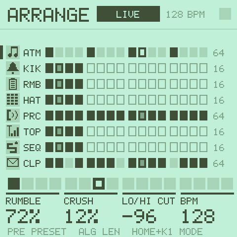 |  | 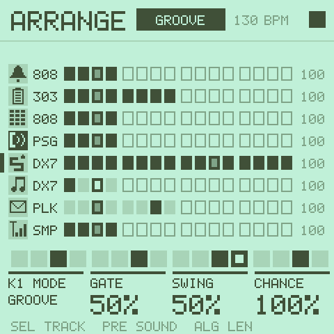 |
| **SPACE** | **USER: editing a knob** | **MUTATE: evolve** |
| 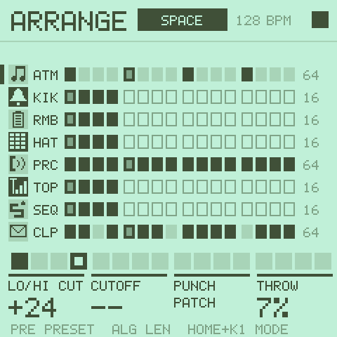 | 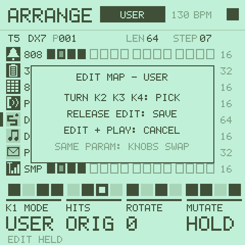 | 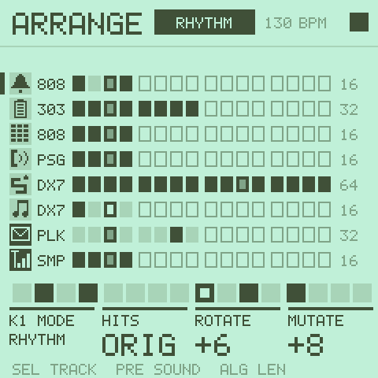 |

### Layer symbols

| Track | Layer | Symbol | What it suggests |
|:---:|---|---|---|
| 1 | ATMOS | Note | holds the drone |
| 2 | KICK | Bell | rings on every hit |
| 3 | RUMBLE | Battery | fills up with low end |
| 4 | HATS | Keypad | ticks like key presses |
| 5 | PERC | Handset | sends out sound waves |
| 6 | TOPS | Signal | shimmers at full bars |
| 7 | SEQ | Snake | loops round and round |
| 8 | CLAP | Message | pings on 2 and 4 |

The symbol belongs to the track number, not to the sound: change the preset and the symbol stays.

## Installation

### What you need

- An **M-VAVE FM-1**, on stock V15 or any FM1 Open build.
- A **USB data cable** (not a charge-only cable), plugged straight into the computer.
- **Desktop Chrome or Edge** on Windows, macOS or Linux. The installer uses Web MIDI with SysEx.
  Safari, Firefox and phones are not supported.

### Before you start

1. Export the projects, voices and samples you want to keep.
2. Keep a copy of the original `FM-1.fwsc` from [M-VAVE's download page](https://www.m-vave.com/download).
3. Close DAWs and any other app or browser tab that uses MIDI.

### Install with the web installer

1. Open the [**installer page**](https://orion-musica.github.io/3310_FM-1/install/). Its ready check
   should show **READY**.
2. Switch the FM-1 on, connect it, press **START INSTALLER** and then **Connect device**. Allow MIDI and
   SysEx when the browser asks.
3. **Coming from stock V15:** the installer sees `FM-1_015`. Click **Enable force flash and reconnect**.
   This only reconnects; nothing is written yet. Coming from FM1 Open? Skip this step.
4. Tick the backup confirmation, click **Force flash** (or **Install**) and accept the warning. Do not
   unplug or switch off while it writes.
5. Wait for the sample check to finish. The FM-1 restarts into the 3310 boot screen.

Each build also comes as a single offline HTML installer (`flasher.html`) and as a bare firmware
package (`3310.fwsc`) with its SHA-256 checksum. You find them in the
[Actions](https://github.com/orion-musica/3310_FM-1/actions) artifacts and on the website.

### Going back to stock

Open the installer and click **Restore original V15**. It installs the original firmware and restores
all 128 factory voices across the four banks. 3310 projects and samples do not work on stock firmware,
so export them first.

## Using 3310

The FM-1 starts on the ARRANGE page. **SEQ** switches between ARRANGE and FM1 Open's own step editor.
**HOME** brings you back to ARRANGE from any page; on ARRANGE, holding it and turning K1 opens the
mode slider. **SAVE** opens the project menu: 1 SAVE PROJECT, 2 LOAD PROJECT (your 16 slots),
3 LOAD PRESET (the 16 factory sets) and 4 NEW PROJECT (the eight layer sounds with no notes, after a
YES / NO question). SELECT, K1 or PRESETS move, keys 1–4 pick, SAVE opens, HOME goes back. All other
buttons work as in FM1 Open.

### Knobs on the ARRANGE page

| Control | Function |
|---|---|
| **SELECT** | Choose the layer (1–8). |
| **PRESETS** | Next / previous preset of the selected layer: sound and pattern. HOME + SAVE undoes it. |
| **ALGORITHM** | Track length: 16, 32, 48 or 64 steps. |
| **HOME (hold) + K1** | Mode slider: LIVE, RHYTHM, GROOVE, SPACE or USER. The name shows inverted in the header. |
| **K1 – K4** | The four parameters of the current mode. |
| **EDIT + PRESETS** | Change the selected track's engine (DX7, 303, 808, PSG, Pluck, Sampler). |

Each row shows the layer's symbol, its tag and its length; the selected layer has a bar at the left
edge. Turning PRESETS shows the layer and the new preset number for a moment.

### Playing live

1. Load a factory set (SAVE → 3 LOAD PRESET), open the mixer (GLO tap) and mute everything but ATMOS.
2. Bring the layers in from top to bottom, one every 8 or 16 bars.
3. Change presets on muted layers, then unmute them.
4. Ride LO/HI CUT, RUMBLE and CRUSH in LIVE mode; mute down to the kick for a breakdown.

### Building your own knob map (USER mode)

1. Hold **HOME** and turn **K1** to **USER**.
2. **Hold EDIT** and turn **K1**, **K2**, **K3** or **K4** to step through the fifteen parameters. The knob labels at
   the bottom show your picks; a changed knob is marked with `*`.
3. **Release EDIT** to keep the new map (**SAVED**), or press **PLAY while holding EDIT** to cancel
   (**CANCELLED**).

- If you pick a parameter that another knob already has, the two knobs swap.
- Changing the map never changes any track's values.
- A short press of EDIT without turning opens the normal sound editor.
- In LIVE, RHYTHM, GROOVE and SPACE the map is fixed: holding EDIT shows **USER ONLY**.

## Parameter reference

| Parameter | Mode | Range | What it does |
|---|---|---|---|
| **HITS** | RHYTHM | ORIG, 0 … length | Spreads the hits evenly: step `s` plays when `(s × hits) mod length < hits`. **ORIG** is your own pattern and the left end of the knob. |
| **ROTATE** | RHYTHM | 0 … length − 1 | Shifts the generated pattern around the loop. |
| **MUTATE** | RHYTHM | −8 … HOLD … +8 | Changes the pattern at every loop wrap. Negative values ERODE: they remove up to 80 % of the hits, fresh each loop. Positive values EVOLVE: hits move to empty steps and the moves add up. HOLD restores the generated pattern. |
| **GATE** | GROOVE | 1 … 15 | Note length of every step. Melodic tracks only. |
| **SWING** | GROOVE | engine range | Global swing of the sequencer. |
| **CHANCE** | GROOVE | 12 % … 100 % | Probability that a step plays, in eighths. |
| **CUTOFF** | SPACE | ±99 | Filter cutoff of the track. Not on DX7 tracks. |
| **PUNCH** | SPACE | engine range | Decay of the amp envelope. DX7 tracks only; switches the envelope on if needed. |
| **THROW** | SPACE | 0 … 15 | Raises the delay send while you turn; the old value comes back 1.5 s after you stop. |
| **REVERB** | USER | 0 … 15 | Reverb send of the track. |
| **VOLUME** | USER | engine range | Track volume. |
| **RUMBLE** | LIVE | OFF … 100 % | Rolling low-end tail made from the whole mix's low band (mostly the kick), ducked under each kick. Whole mix. |
| **CRUSH** | LIVE | OFF … 100 % | Bit depth (15 down to 5 bits) and sample-rate (down to about 7 kHz) reduction. Whole mix. |
| **LO/HI CUT** | LIVE; K1 of RHYTHM, GROOVE, SPACE | −100 … OFF … +100 | Left: 12 dB/oct low cut from 25 Hz to 1.6 kHz. Right: 12 dB/oct high cut from 16 kHz to 200 Hz. Whole mix. |
| **BPM** | LIVE | sequencer range | Tempo; shows `EXT` when following MIDI clock. |

When a parameter does not apply to the selected track, a short notice explains why, for example
`NOT ON DX7`.

## What is not (yet) possible

3310 works within FM1 Open's closed sequencer. That sets a few limits:

- **Track length** is 16, 32, 48 or 64 steps. Free lengths from 1 to 128 would need a new sequencer.
- **Ratchets and nudge** are not available, so GROOVE uses GATE and SWING instead.
- **The FM-1's program memory is full.** FM1 Open alone leaves only a few hundred bytes free. To make room
  for ARRANGE, 3310 drops FM1 Open's old overview page (ARRANGE replaces it) and its Bluetooth settings
  page, uses shorter help texts and stores the original DX7 factory bank with a tighter, lossless
  encoding. Bluetooth MIDI itself still works with its saved settings.
- **HITS, ROTATE, MUTATE, the preset numbers, the live effects and the USER map live in memory.** They
  reset when the FM-1 is switched off.
  What they produce (steps, chances and sends) is part of the project and is saved normally with SAVE.

## Building from source

### In the cloud (recommended)

Every push to `main` builds 3310 on GitHub's own Windows machines. The workflow is
[`.github/workflows/build.yml`](.github/workflows/build.yml). It:

1. downloads JieLi's Windows toolchain 2.5.3 and unpacks or installs it;
2. builds the firmware, the web installer and the website with `tools/Make-Site.ps1`;
3. uploads the firmware, the installer and `SHA256SUMS.txt` as the **3310** artifact;
4. publishes `docs/` to GitHub Pages, with an installer that is ready to use.

To run it by hand: **Actions → build → Run workflow**. For the website, set
**Settings → Pages → Source** to **GitHub Actions** once.

### On Windows

Requires Windows x64, PowerShell and **JieLi Windows toolchain 2.5.3** (PI32v2 clang 4.0.1, `r3`
target). The build checks all toolchain files against `sdk/manifest.json`. See
[README.FM1-OPEN.md](README.FM1-OPEN.md) for the download and the installation guide.

The easy way: double-click **`INSTALL-3310.bat`**. It finds the toolchain under `C:\JL\pi32`, builds
everything and opens the installer at `http://localhost:8766`. **`OPEN-SITE.bat`** opens the site
again later without building.

By hand, in PowerShell from the repository root:

```powershell
$env:FM1_PI32_TOOLCHAIN = 'C:\JL\pi32'

# Browser simulator only
.\tools\Build-Web.ps1 -LocalPreview

# Firmware only, for local tests on your own FM-1
.\sdk\Build.ps1 -FirmwareOnly -Toolchain $env:FM1_PI32_TOOLCHAIN

# Distribution package + website in docs\
$env:FM1_SOURCE_URL = 'https://github.com/orion-musica/3310_FM-1/archive/refs/heads/main.zip'
.\tools\Make-Site.ps1
```

| Output | Where |
|---|---|
| Firmware package | `build/dx7/generated/FM1_OFFICIAL_OPEN.fwsc` → `docs/downloads/3310.fwsc` |
| Offline web installer | `build/official-web/FM1-Official-Open-Source.html` → `docs/install/flasher.html` |
| Checksum | `docs/downloads/SHA256SUMS.txt` |
| Build info for the installer page | `docs/assets/build-info.js` |

## Project layout

| Path | Contents |
|---|---|
| `app/hlv.inc` | **The ARRANGE module:** modes, parameters, USER editing, mutation, layer symbols, the mode slider, the SNAKE light show and drawing. |
| `app/presets.c`, `app/hypno.h` | The eight hypnotic layers, their preset recipes and the sixteen factory sets. |
| `app/audio_output.c` | Output stage with the live master effects (RUMBLE, CRUSH, LO/HI CUT). |
| `app/screen.c` | FM1 Open's panel code with small hooks: the LCD palette, the ARRANGE page, the boot screen and button routing. |
| `app/` (rest) | FM1 Open application code: audio, MIDI, projects, samples, presets. |
| `sdk/` | FM1 SDK: build script, engine library, headers, packaging tools, stock V15 recovery image. |
| `web/`, `third_party/` | Browser simulator engine and synth sources. |
| `docs/` | Website, installer page, downloads and screenshots (GitHub Pages). |
| `docs/design/` | Design concept images of every planned screen. |
| `tools/` | Site build (`Make-Site.ps1`), local server (`Serve-Site.ps1`), one-click install (`Install-Local.ps1`). |
| `.github/workflows/` | Cloud build and Pages deployment. |

## How it works

- **Screen.** The ST7789 display (240 × 240, RGB565) is painted in bands 16 rows high. Every area of
  the ARRANGE page keeps a signature of what it shows and is redrawn only when that changes, so the page
  stays light on the CPU while the music plays.
- **Engine access.** The module only uses FM1 Open's public instrument API (`app/instrument.h`): reading
  and replacing sequence steps, per-step gate and probability, track controls, sends and the DX7
  envelope. Nothing in the closed engine is patched.
- **Patterns.** HITS and ROTATE compute a Euclidean pattern from a snapshot of your own steps, so ORIG
  can always bring the original back. MUTATE runs when a track wraps from its last step to its first.
- **Layer presets** are small recipes (a DX7 factory program, 808 kit values, a 303 or pluck sound,
  and a pattern rule such as a mask or an odd-length cycle) expanded into a normal project row and
  applied to one track with the engine's own timbre API, so a preset change can be undone.
- **Live effects** run in the audio interrupt from RAM in 32-bit integer arithmetic: two one-pole
  stages per filter, a sample-and-hold crusher, and for RUMBLE a low band fed into two combs at
  11 kHz with a level follower that ducks the tail under the kick.
- **Track symbols** are 12 × 12 one-bit bitmaps in `app/hlv.inc`, drawn as runs of pixels in a 14 × 14
  box. On a hit, the box turns dark and the symbol light.
- **Testing.** A host harness compiles the real `screen.c` against a fake engine with AddressSanitizer
  and UndefinedBehaviorSanitizer, simulates knob turns and button presses, and writes every screen as an
  image. The screenshots in this README come from it.

## Design concepts

`docs/design/` holds a concept image for every screen of the full 3310 interface. They show
where the project is heading. **Only the boot screen and the ARRANGE pages (images 01 and 03–08) are
in the firmware today.** The other screens use FM1 Open's own pages for now.

<table>
<tr>
<td align="center">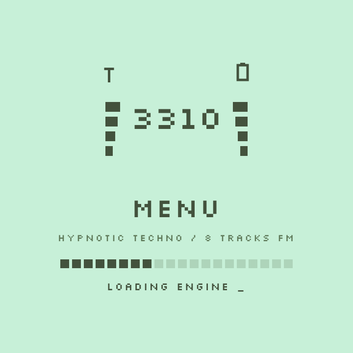<br><sub>Boot</sub></td>
<td align="center">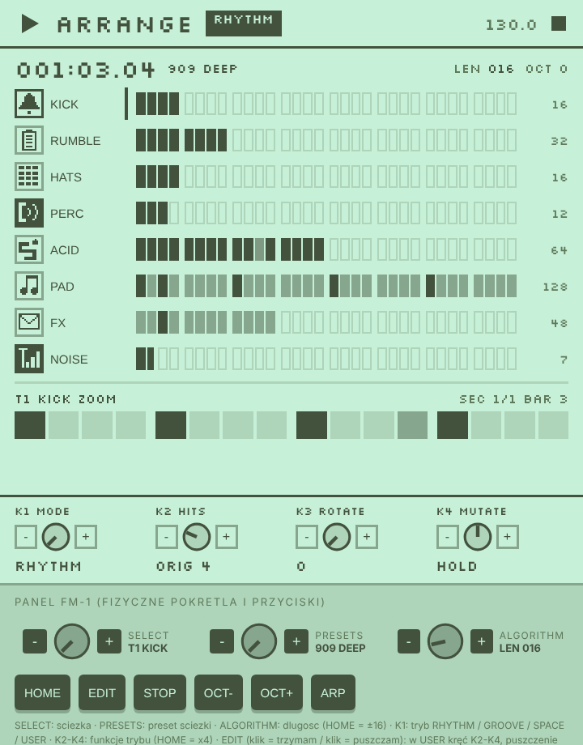<br><sub>Arrange</sub></td>
<td align="center">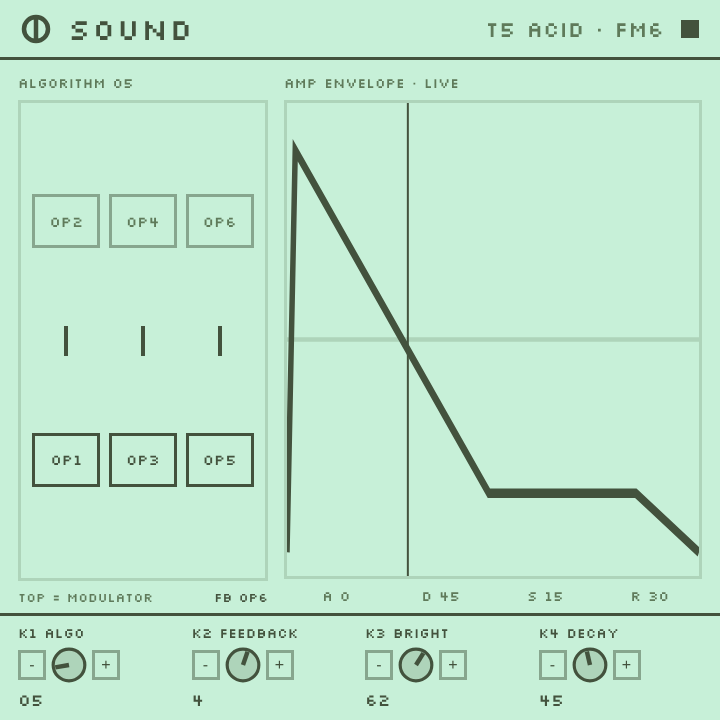<br><sub>Sound · FM6</sub></td>
<td align="center">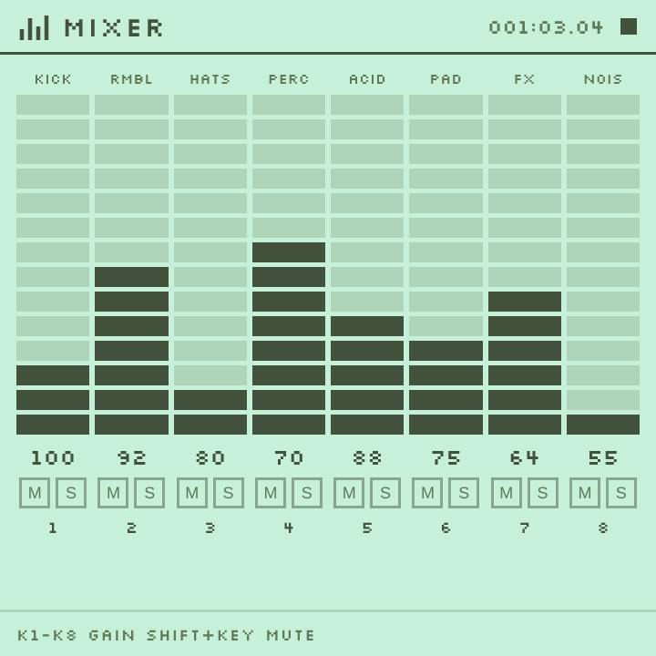<br><sub>Mixer</sub></td>
</tr>
<tr>
<td align="center">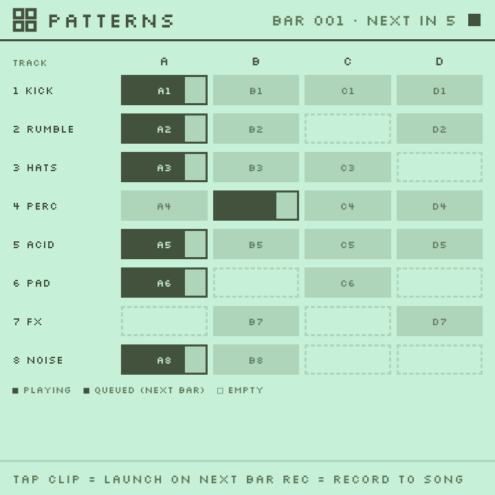<br><sub>Patterns · clips</sub></td>
<td align="center">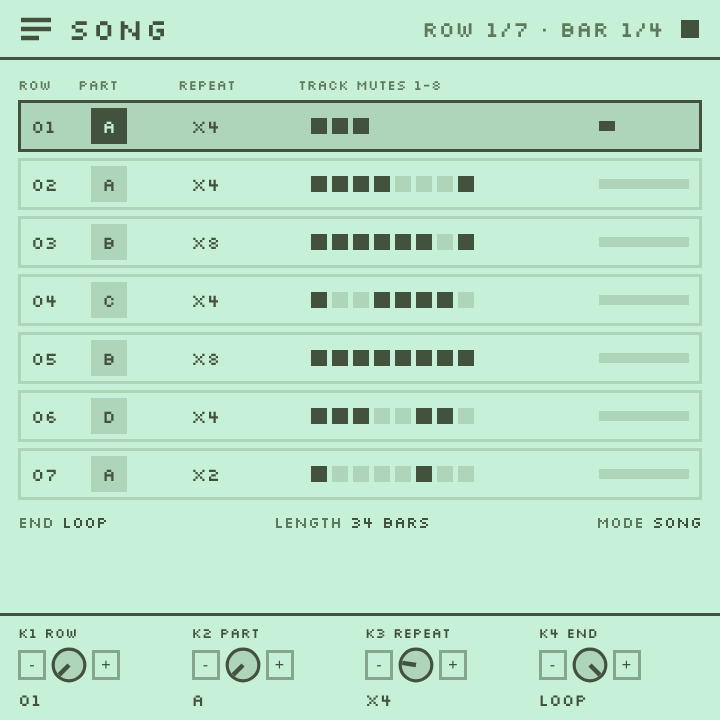<br><sub>Song</sub></td>
<td align="center">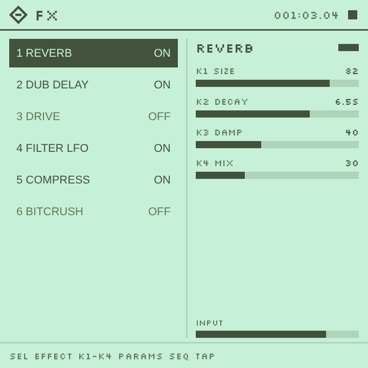<br><sub>FX</sub></td>
<td align="center">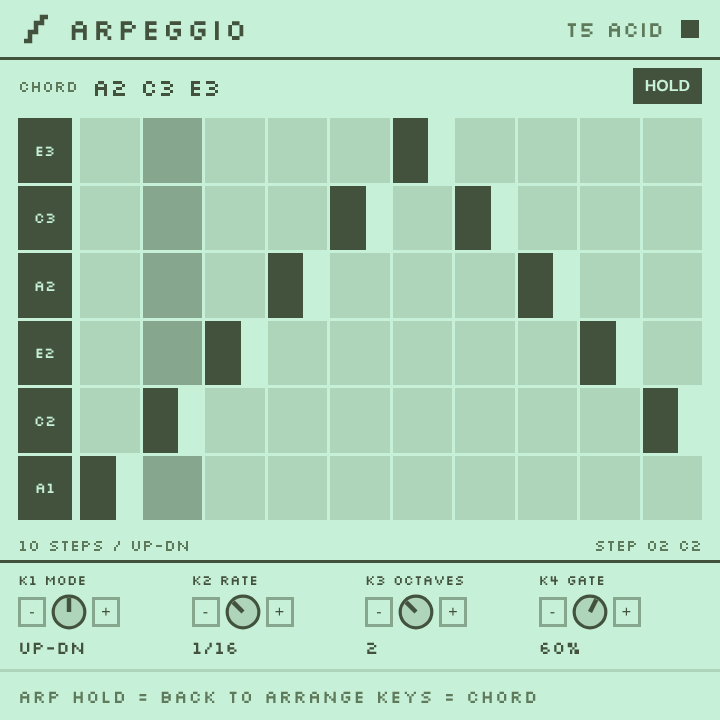<br><sub>Arpeggio</sub></td>
</tr>
</table>

## Troubleshooting

| Problem | What to do |
|---|---|
| The browser does not find the FM-1 | Close other MIDI apps and installer tabs, switch the FM-1 off and on, reconnect USB and click Connect again. The installer's **Connection details** lists the MIDI ports it found. |
| START is greyed out | The ready check on the installer page says why: wrong browser, page opened as a file, or no build yet. |
| The update stopped halfway | Keep the cable in, power-cycle the FM-1, reconnect and run the installer again with force flash. |
| The installer page says **NOT BUILT** | No build has finished yet. Wait for the cloud build, or build locally with `INSTALL-3310.bat`. |
| A knob shows `… ONLY` or `NOT ON DX7` | That parameter does not apply to the selected track's sound source. Pick another track or mode. |
| Patterns reset after power-off | HITS, ROTATE, MUTATE and the USER map are not stored yet; press SAVE to keep the resulting steps. |

## Contributing

Bug reports and ideas are welcome in [Issues](https://github.com/orion-musica/3310_FM-1/issues). For a
bug, please include:

- what you did and what you expected;
- a photo of the screen if you can;
- the build's SHA-256 from the installer page;
- whether you came from stock V15 or FM1 Open.

Pull requests are welcome too. Please keep changes to the ARRANGE module in `app/hlv.inc` and test them
with a cloud build before opening the pull request.

## Credits

- **3310:** BULØKE. The code was written together with Claude.
- **FM1 Open:** M-VAVE (珠海笙科智能科技有限公司), the base firmware, SDK and web installer.
- **Third-party components** (Open303, DaisySP, stmlib, MSFA / Dexed, emu2149, SEA codec, jl-misctools
  and others): see [THIRD_PARTY.md](THIRD_PARTY.md).

## License

3310's application code is licensed under **GPL-3.0-only with the FM1 SDK linking exception**, like
FM1 Open; see [LICENSE.md](LICENSE.md). The engine in `sdk/lib/libfm1_engine.a` is M-VAVE's binary SDK
under its own terms, and the boot and recovery resources are Apache-2.0; see
[THIRD_PARTY.md](THIRD_PARTY.md). If you share a firmware built from this code, share its source too.

3310 is a community project. It is not affiliated with or endorsed by M-VAVE or any phone maker.
Installing custom firmware is at your own risk.
